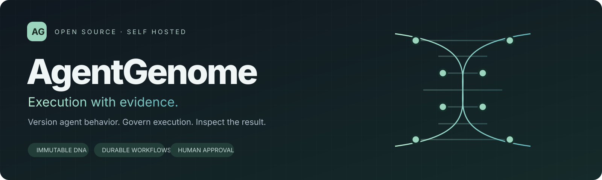
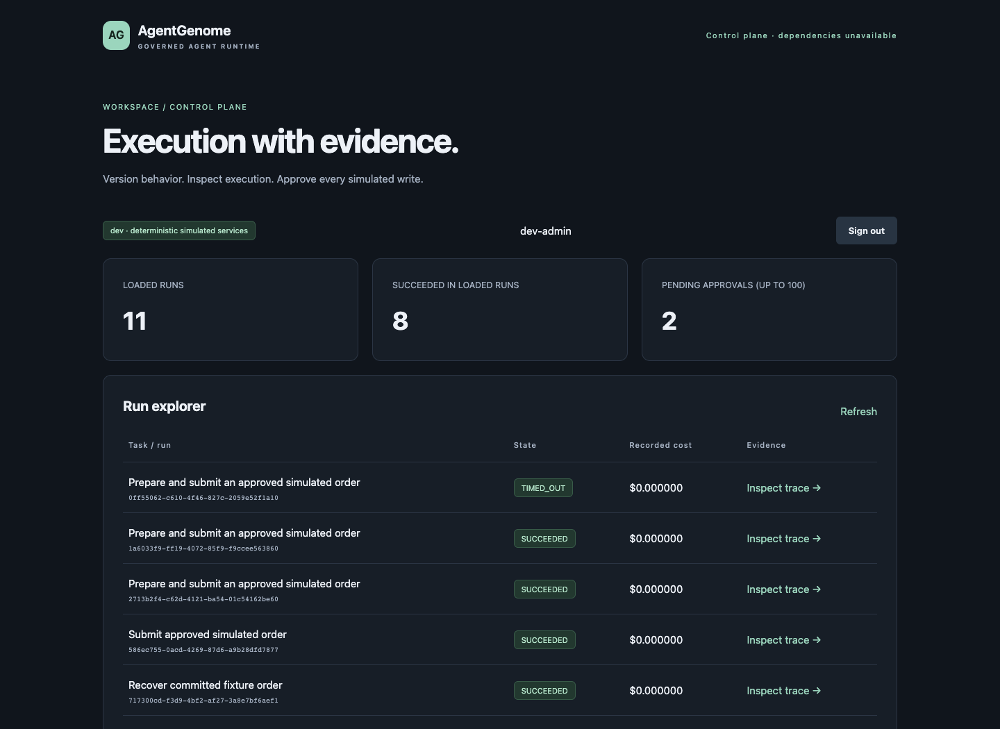
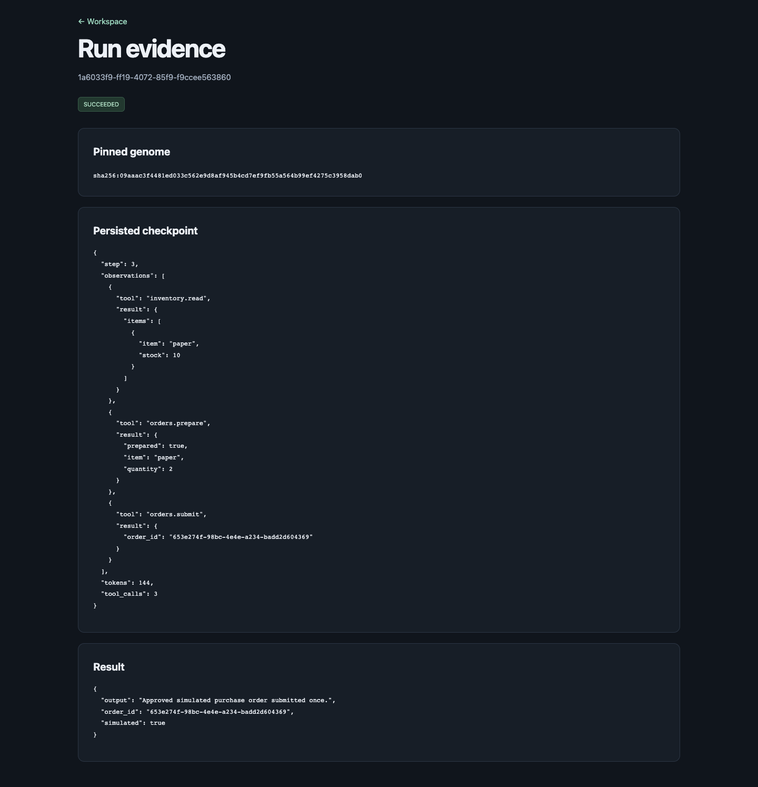
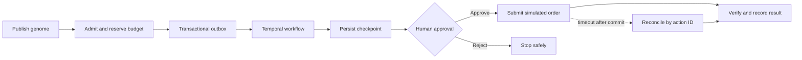

<p align="center">
  
</p>

<p align="center">
  <strong>A self-hosted foundation for versioning, governing and inspecting agent execution.</strong>
</p>

<p align="center">
  <a href="LICENSE"></a>
  
  
  
</p>

<p align="center">
  <a href="#quickstart">Quickstart</a> ·
  <a href="#see-it-in-action">Screenshots</a> ·
  <a href="#the-workflow">Workflow</a> ·
  <a href="#custom-mcp-server">MCP server</a> ·
  <a href="docs/architecture.md">Architecture</a> ·
  <a href="docs/development.md">Development</a> ·
  <a href="docs/roadmap.md">Roadmap</a>
</p>

---

AgentGenome treats an agent's operational configuration as an immutable **genome**. Publish a version, execute it through a durable workflow, approve sensitive actions, and inspect the evidence recorded along the way.

> [!IMPORTANT]
> **This is a development preview, not a production release.** The current executable path is a deterministic procurement agent with real PostgreSQL persistence and Temporal orchestration. Purchases and model responses are simulated. Production startup remains blocked while mandatory isolation and governance controls are unfinished. [See production readiness →](docs/roadmap.md#production-readiness)

## See it in action

**Workspace:** recorded runs, execution states, approvals and genome publication, backed by the actual API.



<details>
<summary><strong>Open a completed run: pinned genome, checkpoint and result</strong></summary>



</details>

Screenshots are captured from the running development application. Regenerate them with `make screenshots`; normal tests write their captures to ignored test-output directories.

## What works today

| Capability               | Behavior                                                                                             |
| :----------------------- | :--------------------------------------------------------------------------------------------------- |
| **Versioned genomes**    | Strict manifest validation, canonical SHA-256 hashes and immutable publication.                      |
| **Durable execution**    | Temporal workflows execute registered procurement fixture tools and persist checkpoints.             |
| **Human approval**       | Order submission waits for an approval bound to the exact action and argument digest.                |
| **Recovery**             | A killed worker resumes; an ambiguous committed order is reconciled instead of submitted again.      |
| **Budget reservations**  | Concurrent admissions reserve tenant budgets atomically; terminal runs release reservations.         |
| **Tenant boundaries**    | Initial resources use scoped authorization, PostgreSQL row-level security and negative access tests. |
| **Execution evidence**   | Ordered persisted events, SSE replay, checkpoint inspection and terminal results.                    |
| **Custom MCP server**    | Ten scoped tools over local stdio, using the existing API and human approval boundary.               |
| **Developer interfaces** | FastAPI/OpenAPI, an initial Python client and CLI, and generated TypeScript API types.               |

Live model execution, the full skill/memory system, generated-code sandboxes, reliability lab and governed evolution are still on the [roadmap](docs/roadmap.md).

## Quickstart

### 1. Prerequisites

- Python **3.11–3.13**, [uv](https://docs.astral.sh/uv/), Node.js **24**, npm and Docker Compose.
- On Intel macOS, cryptography 50.x requires Xcode command-line tools, Rust and OpenSSL. See the [native build instructions](docs/development.md#intel-macos).

From the repository root:

```sh
make bootstrap
make infra-core
make migrate seed-core
```

`bootstrap` creates a private `.env` and generates a unique development access token. Existing custom secrets are preserved. The core profile starts PostgreSQL, Temporal, Redis and Keycloak on loopback interfaces.

### 2. Start the application

Use three terminals:

| Terminal | Command          | Service                                                |
| :------- | :--------------- | :----------------------------------------------------- |
| 1        | `make api`       | API and interactive docs at http://127.0.0.1:8080/docs |
| 2        | `make worker`    | Durable execution and outbox dispatch                  |
| 3        | `make dashboard` | Studio at http://127.0.0.1:3000                        |

Open the studio, copy **`AG_DEV_TOKEN` from your local `.env`** into **Access token**, and click **Connect**. There is no shared default password.

> [!NOTE]
> The core demo works without object storage. Until S3/MinIO is configured, `/readyz` returns `503` with `artifacts: unavailable`, and the studio displays a dependency warning. `/healthz` is liveness only. The full storage profile is documented under [local services](docs/development.md#local-services).

### 3. Run the procurement example

1. In **Publish & execute**, keep the supplied manifest or use [the example genome](examples/genomes/procurement.json).
2. Select **Publish genome and start run**.
3. Refresh the workspace until the run reaches **WAITING_APPROVAL**.
4. Review the simulated order in **Approval inbox**, then approve or reject it.
5. Refresh again. Select **Inspect trace** on the completed run to see its pinned hash, checkpoint and result.

For a command-line demonstration against the same API and worker:

```sh
make e2e
```

No model-provider account or real financial credentials are needed for this workflow.

## The workflow



The model does not grant itself permissions. Registered tools, admission checks and approval enforcement sit outside the fixture provider. Published genome hashes stay pinned for in-flight runs.

## Custom MCP server

AgentGenome includes its own **Model Context Protocol server**, built with the official Python SDK. An MCP-compatible local client can use it to create agents and genomes, publish versions, start runs and inspect results through the same authorized API.

With the API running:

```sh
make mcp-config
make mcp-smoke
```

The first command generates a private **`.local/mcp.json`** client configuration with an expiring service API key. Copy its `mcpServers.agentgenome` entry into your client's MCP settings. The command path is absolute, so the client can launch it from another directory. Keep this file private; it contains a credential and is ignored by Git. Regenerating it rotates the previous key on the same API server.

| MCP tools                                         | Purpose                                                 |
| :------------------------------------------------ | :------------------------------------------------------ |
| `get_identity`, `list_agents`, `list_runs`        | Inspect the service identity and authorized resources.  |
| `create_agent`, `create_genome`, `publish_genome` | Register agents and publish immutable configurations.   |
| `get_genome`, `get_run`                           | Read manifests, pinned hashes, checkpoints and results. |
| `start_run`, `cancel_run`                         | Admit idempotent runs and request cancellation.         |

**Approval is deliberately a human action in the studio.** The generated MCP key grants `read`, `write` and `run`, without `approve` or `admin`. Tools cannot create API keys or approve their own orders. Budgets, tenant authorization and supported-route checks remain enforced by the API.

This server uses **local stdio**, not a public `/mcp` HTTP endpoint. It exposes AgentGenome to a client; connecting AgentGenome agents to arbitrary external MCP servers is separate roadmap work. Its API connection accepts loopback HTTP or operator-configured HTTPS, with deadlines, response limits and redirect rejection.

For manual configuration, launch `.venv/bin/agentgenome-mcp` with `AG_MCP_API_URL` and a scoped `AG_MCP_API_TOKEN` in its environment. The server writes MCP messages to stdout and diagnostics to stderr. To add your own tool, extend `packages/agentgenome/mcp_server.py` with a typed `@server.tool()` function that calls an authorized API operation, and add permission/failure-path tests.

## Development and verification

```sh
make lint typecheck test   # Formatting, strict types, unit and security tests
make integration           # Real migrated PostgreSQL required
make e2e                   # API + ordinary Temporal worker required
make e2e-ui                # API + worker + studio + browser required
make build                 # Python packages, dashboard and TypeScript SDK
```

The crash-after-commit check starts and terminates its own test workers. Stop the ordinary worker first, run `make recovery`, then restart `make worker`. [Full test and browser instructions →](docs/development.md#verification)

### GitHub workflows

| Workflow                                   | When                                          | Checks and outputs                                                                                                   |
| :----------------------------------------- | :-------------------------------------------- | :------------------------------------------------------------------------------------------------------------------- |
| [CI](.github/workflows/ci.yml)             | Pushes, pull requests and manual runs         | Python checks, real PostgreSQL tests, dashboard/SDK builds, actual API/Temporal/browser demo and worker recovery.    |
| [Security](.github/workflows/security.yml) | Pushes, pull requests, weekly and manual runs | Python/npm advisory audits and CodeQL analysis for Python and TypeScript.                                            |
| [Packages](.github/workflows/packages.yml) | Version tags and manual runs                  | Tested Python distributions, TypeScript package, SBOM and container build checks; artifacts are retained in Actions. |

Actions are pinned to commit hashes. Dependabot maintains action and npm updates. No workflow deploys infrastructure or publishes packages automatically. The workflows need their first run in your GitHub repository; local checks are not a claim of GitHub CI success.

## Repository map

```text
apps/                 FastAPI control plane and Next.js studio
packages/agentgenome/  Runtime, schemas, authorization, persistence and migrations
workers/              Temporal orchestration and outbox dispatcher
sdk/typescript/       Generated API types and initial client
examples/             Executable procurement genome
scripts/              Setup, demos, recovery checks and API generation
tests/                Unit, security and PostgreSQL integration tests
infrastructure/       Local Compose services and container builds
docs/                 Architecture, development guide, roadmap and screenshots
```

## Contributing and security

Read [Contributing](CONTRIBUTING.md) for the local checks and [Security](SECURITY.md) for the trust boundaries and reporting policy. Keep `.env`, credentials, databases, generated packages and test reports out of commits; the ignore rules cover these files.

Licensed under [Apache-2.0](LICENSE). Owner attribution and a verified private security-reporting channel must be confirmed before a public release. This repository does not claim compliance certification or production readiness.
