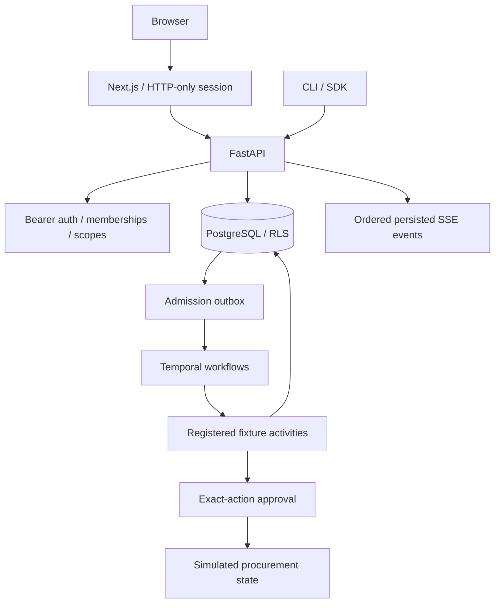
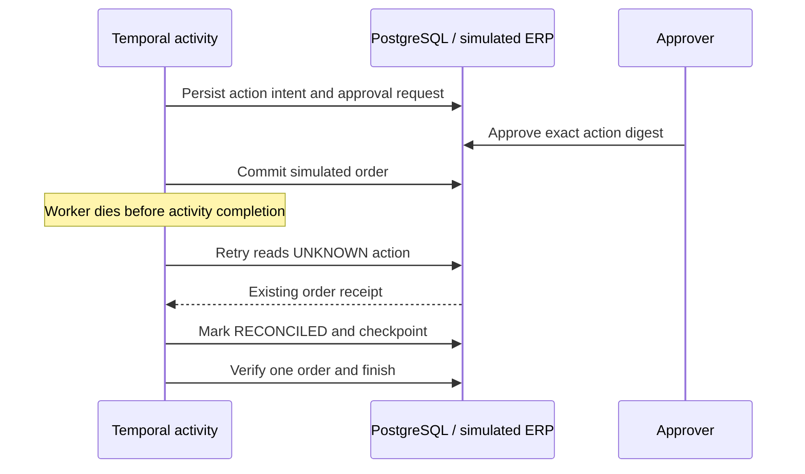

# Architecture

AgentGenome currently uses a Python modular monolith, a Next.js studio, PostgreSQL and Temporal. Domain modules stay under one Python distribution instead of empty per-feature packages. Redis and S3 integrations report dependency readiness; full cache/artifact subsystems are unfinished.

## Admission and execution

1. Validate the manifest and resolve published parents within the tenant.
2. Publish a canonical manifest hash; database triggers prevent later mutation.
3. Admission verifies the executable subset and reserves the maximum cost under a tenant lock.
4. The run and outbox record commit together. Dispatch uses a stable workflow ID and deduplicates starts.
5. Activities lock a run and persist tool actions, results, checkpoints and event sequence changes transactionally.
6. Mutating procurement actions require a valid, unused approval bound to the exact argument digest.
7. Terminal transitions release reservations once. Database triggers reject later changes to terminal runs.

## Failure and recovery

The recovery check verifies this scenario with a real killed process. It does not establish exactly-once behavior for external systems. An external connector needs idempotency and reconciliation before equivalent guarantees can be advertised.

## Boundaries and decisions

- PostgreSQL is authoritative. FORCE RLS and application filters scope the initial domain tables per transaction.
- Authentication catalogs are separate logical tables; restricted service/catalog DB roles are still needed.
- Temporal is the only durable execution queue. Redis is ephemeral; no second authoritative queue is introduced.
- The browser holds an HTTP-only, SameSite token cookie. Server actions call the API, where authorization is enforced again.
- The executable provider is an explicit deterministic fixture with synthetic usage units and zero external model cost.
- The OpenAI-compatible adapter has mocked HTTP contract tests but is not admitted by runtime. Anthropic and live accounting remain pending.
- No generated programs or untrusted skills execute on the host. A hardened sandbox is not implemented, so production configuration is rejected.

See [Security](../SECURITY.md) for the threat model and [Roadmap](roadmap.md) for unsupported behavior.
